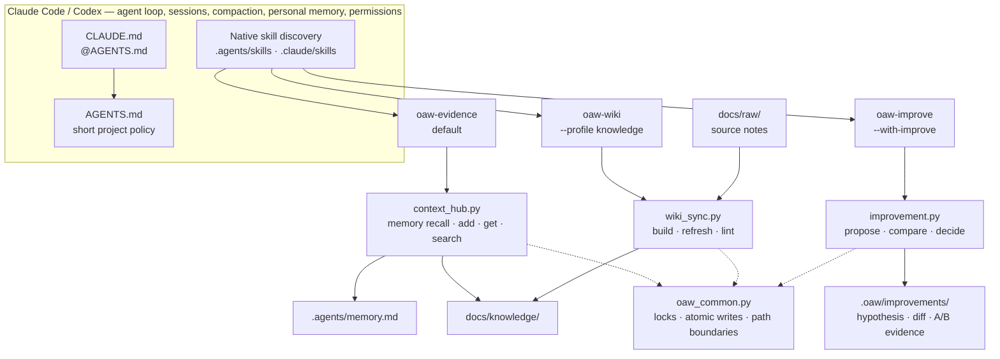
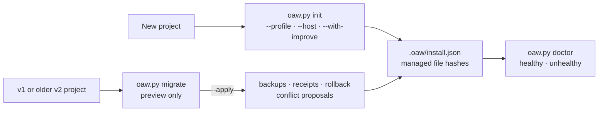

# 🍲 O-ALL-WANT (OAW) Framework

<div align="center">

[](https://opensource.org/licenses/MIT)
[](https://github.com/lihowfun/O-ALL-WANT/stargazers)
[](https://github.com/lihowfun/O-ALL-WANT/commits/main)
[](https://github.com/lihowfun/O-ALL-WANT/issues)
[](https://github.com/lihowfun/O-ALL-WANT/actions/workflows/test.yml)

</div>

<div align="center">
  <a href="README.md">English</a> |
  <a href="README.zh.md">中文</a> |
  <a href="https://www.readme-i18n.com/lihowfun/O-ALL-WANT?lang=ja">日本語</a> |
  <a href="https://www.readme-i18n.com/lihowfun/O-ALL-WANT?lang=ko">한국어</a> |
  <a href="https://www.readme-i18n.com/lihowfun/O-ALL-WANT?lang=de">Deutsch</a> |
  <a href="https://www.readme-i18n.com/lihowfun/O-ALL-WANT?lang=fr">Français</a> |
  <a href="https://www.readme-i18n.com/lihowfun/O-ALL-WANT?lang=es">Español</a>
</div>

> Why choose when you can have it all?
> Kids choose. Builders want the whole stack.

<p align="center">
  
</p>

> **v2.0.0 is proposed in a pull request; it is not a published release.** [Upgrade guide](docs/UPGRADING.md) · [CLI reference](docs/CLI_Reference.md) · [Execution plan](docs/plans/v2.0.0-execution.md)

## 20-second pitch

OAW adds what your coding agent cannot reconstruct from code alone, and leaves everything else to the agent:

- **Project evidence**: decisions, external constraints and experiments, recalled with their sources when a task needs them.
- **Native skills**: standard `SKILL.md` packages for Claude Code and Codex, installed from one source.
- **Optional wiki**: raw notes rendered into searchable knowledge pages.
- **Proof-gated improvements**: a rule or skill change needs a concrete diff and matched A/B evidence before you accept it.

Claude Code or Codex keeps the agent loop, sessions, compaction, personal memory, permissions and skill discovery.

```bash
git clone https://github.com/lihowfun/O-ALL-WANT.git OAW
python3 OAW/scripts/oaw.py init --target /path/to/project --host both
python3 OAW/scripts/oaw.py doctor --target /path/to/project
```

## Why are you here?

This is a harness for unapologetically greedy agentic coders.

If you hop between AI coding platforms and treat token efficiency like a competitive sport, you probably know the heartbreak: the chat gets long, the agent gets stupid, the session resets, and suddenly you are paying premium tokens just to re-explain the repo before any real work happens. You do not even reach the hard part before seeing `You have hit your limit`.

OAW is my answer to that waste.

It came out of too many late nights pushing Claude Code and Codex harder than any reasonable coworker should, then taking the sharpest bits from other people's public work — Context Hub, MemPalace, Karpathy-style LLM Wiki patterns, Garry Tan's thin-harness / fat-skills framing — and stewing them into one unapologetically overloaded hot pot.

**v2 is the same hot pot after a deep clean.** Claude Code and Codex now cook the base broth themselves: sessions, compaction, memory and skill discovery are native. So OAW stopped re-cooking them and only adds what the host cannot know: why your project is the way it is, and proof before any "improvement" sticks.

The goal is still simple: **spend expensive tokens on real reasoning and real output** — not on replaying finished work or reteaching the project every time a session dies.

> **Only want one piece of this?** Fork the original project that does that one thing best (see Source lineage below). This repo is for people who want the whole hot pot. For a quick positioning map, see [How OAW differs](docs/COMPARISON.md).

---

## 🍲 What's in the hot pot? (v2.0.0)

| | Ingredient | What it does in v2 | You get it with |
|---|---|---|---|
| 🧭 | **Native-first core** | A short `AGENTS.md` for non-obvious constraints and real verification commands; `CLAUDE.md` only imports it. No router, no mandatory startup reads | default |
| 🧾 | **Evidence recall (Context Hub)** | `context_hub.py memory recall` returns bounded JSON or text with source locations, truncation and a continuation cursor. Notes are evidence to check against current code, never instructions that override you | default |
| 🧩 | **Native skills** | Three standard `SKILL.md` packages. `--host codex\|claude\|both` installs `.agents/skills` and/or `.claude/skills` from one authored source | `oaw-evidence` by default; the others below |
| 📚 | **LLM Wiki** | `wiki_sync.py` deterministically renders `docs/raw/` into `docs/knowledge/` and lints links, metadata and freshness. It is a renderer, not an LLM summarizer | `--profile knowledge` |
| 🔬 | **Evidence-driven self-improvement** | Hypothesis + concrete diff → fixed cases on matched baseline/candidate runs → your explicit accept or reject. Regressions, missing or changed evidence block acceptance; nothing is ever applied automatically | `--with-improve` |
| 🛟 | **Safe lifecycle** | `init` protects existing content; `migrate` previews by default and `--apply` keeps backups, receipts, rollback and conflict proposals; `doctor` reports health | always |
| 🔒 | **Safe writes** | Locked read-modify-write, atomic replacement, and refusal of symlink/junction or path escapes | always |
| 📉 | **Compact output** | `search --compact` and `--max-chars` budgets keep tool output short | default |
| ✅ | **Proof gate** | `harness_check.py`: 8 check groups, every required test module, a minimum test count and zero skips; CI on Ubuntu, macOS and Windows with Python 3.10 and 3.13 | this repo |

### 🥄 Scooped out of the pot in v2

| Removed | Why |
|---|---|
| `CLAUDE.md` Master Router and its lanes | The host decides what to read and discovers native skills itself |
| Placeholder `AI_CONTEXT.md`, `ROADMAP.md`, root `VERSION.json` | Mirrors of state went stale. No longer created; your existing files are preserved |
| `do_not_rerun` state machine | Historical notes are history, not permanent runtime restrictions |
| Flat trigger-scanned skills and keyword "Skills-First" dispatch | Replaced by native `SKILL.md` discovery |
| Mandatory memory writes, wrap-up reports and skill-review nudges | Personal memory is native now; record only reusable project evidence |
| Copilot / Cursor / Windsurf / Gemini pointer files | v2 targets Claude Code and Codex; unchanged old adapters retire into backups on migrate |
| The "86–87% less startup context" headline | A v1 comparison of selected Markdown against loading everything; kept as history, not a v2 benchmark |

---

## 🏗️ Architecture

**At work**: the host runs the agent. OAW contributes a short policy, three native skills and small standard-library tools that read and write project files.



**On install and upgrade**: every write is previewed, backed up or refused.



### 🛡️ Three load-bearing principles (v2)

| Principle | Implementation | Problem solved |
|---|---|---|
| **Native-first** | Short `AGENTS.md`; skills load on demand; no second agent runtime | Two systems fighting over sessions, memory and startup context |
| **Evidence, not instructions** | Recall returns sources and revisions; notes are checked against current code; retrieved text never overrides the user | Stale or injected notes steering the agent |
| **Proof before promotion** | Improvements need a diff and matched A/B evidence; installer changes pass the gate; nothing applies itself | "Self-improvement" that only piles up rules |

---

## 🔁 What OAW adds on top of a native host

v1 was built when coding agents forgot everything between sessions. Today Claude Code and Codex read project instruction files, keep their own memory and discover skills natively. So the honest comparison is not "with or without OAW" but "native host alone" versus "native host + OAW".

| When the agent needs… | Native host alone | Native host + OAW v2 |
|---|---|---|
| Project rules and real verification commands | Reads its own instruction file (`AGENTS.md` for Codex, `CLAUDE.md` for Claude Code) | One short `AGENTS.md` shared by both hosts; `CLAUDE.md` just imports it |
| Your personal preferences across sessions | The host's own memory, where enabled | Left to the host; OAW adds nothing here on purpose |
| Why the project made a decision | Personal memory or chat history: not in the repo, not shared with the team or the other host | Project evidence in the repo with its source, revision and scope; `memory recall` returns bounded excerpts |
| To trust an old note | Up to the agent's judgment | The evidence skill says to check it against current code and mark superseded conclusions |
| The same skills in both hosts | A separate folder and copy per host | One authored source installs `.agents/skills` and `.claude/skills`; `doctor` checks them |
| A new rule or skill | Added whenever someone writes it | Optional `oaw-improve`: a diff, matched A/B evidence and your explicit accept |

> No v2 token-savings number is claimed. Native Claude Code / Codex A/B runs and live skill discovery are not yet measured; see [local validation](docs/validation/v2.0.0-local.md).

---

## ⚡ Quick start

Requires Python 3.10+; the runtime uses only the standard library. From the OAW checkout:

```bash
python3 scripts/oaw.py init --target /path/to/project            # Codex skills (default)
python3 scripts/oaw.py init --target /path/to/project --host both
python3 scripts/oaw.py doctor --target /path/to/project
```

The default installs five framework files: a short `AGENTS.md`, the Claude compatibility import, one evidence skill, and Context Hub with its shared helper. It creates no memory log, placeholder architecture or mandatory session workflow. Existing different content is protected.

Optional capabilities are additive on an existing installation:

```bash
python3 scripts/oaw.py init --target /path/to/project --profile knowledge   # wiki renderer + wiki skill
python3 scripts/oaw.py init --target /path/to/project --with-improve        # proof-gated improvements
```

The Bash shortcut, run from the target project, is `bash /path/to/O-ALL-WANT/install.sh`. Examples: [minimal](example/minimal-project/) · [knowledge and improvement](example/public-hybrid-demo/)

### 📂 Upgrade an existing OAW project

```bash
python3 scripts/oaw.py migrate --target /path/to/project           # preview only
python3 scripts/oaw.py migrate --target /path/to/project --apply   # backups + proposals
```

Known unmodified framework files update. Custom policy and skills become proposals and are never overwritten. Memory, knowledge, raw notes, `AI_CONTEXT.md`, `ROADMAP.md` and root `VERSION.json` stay yours. Review unresolved proposals before treating the migration as done. See [UPGRADING](docs/UPGRADING.md).

### 🔌 Hosts

| Host | Policy file | Skills folder |
|---|---|---|
| **OpenAI Codex** | `AGENTS.md` | `.agents/skills/` (`--host codex`, default) |
| **Claude Code** | `CLAUDE.md` → `@AGENTS.md` | `.claude/skills/` (`--host claude`) |
| Both | same shared policy | both folders from one source (`--host both`) |

OAW does not silently edit host settings. `doctor` reports what is supported separately from what is enabled. Local schema tests do not prove live skill discovery in either host. See the [Skill Guide](docs/Skill_Guide.md).

---

## 🔧 Direct CLI

Run these from an installed project:

| Command | Purpose |
|---|---|
| `python3 scripts/context_hub.py memory recall "cache decision" --json --max-chars 12000` | Bounded recall with sources and continuation |
| `python3 scripts/context_hub.py memory add "[DECISION] Keep the cache local — evidence: docs/experiment.md"` | Record durable evidence |
| `python3 scripts/context_hub.py get Cache_Decision` | Read one knowledge page |
| `python3 scripts/context_hub.py search "keyword" --compact` | One-line topic search |
| `python3 scripts/wiki_sync.py refresh Topic` · `lint` | Render and check the wiki (knowledge profile) |
| `python3 scripts/improvement.py --help` | Propose, compare and decide improvements (`--with-improve`) |

Full list: [CLI Reference](docs/CLI_Reference.md) · [Self-improvement guide](docs/SELF_IMPROVEMENT.md)

---

## 🐕 Self-hosting: the repo is its own first user

The root `AGENTS.md` and `CLAUDE.md` are the OAW team's own working copies, not the template you install. The installable version lives in `templates/`, and the generated examples are checked byte for byte against the installer.

```bash
python3 scripts/harness_check.py
python3 scripts/sync_examples.py --write
```

See [CONTRIBUTING](CONTRIBUTING.md) and [CHANGELOG](CHANGELOG.md).

---

## Source lineage (standing on the shoulders of giants)

**Used in v2.0.0**

- 📉 **[andrewyng/context-hub](https://github.com/andrewyng/context-hub)** (MIT) — the architecture of `context_hub.py`: searchable knowledge, annotations, retrieval
- 🧠 **[MemPalace](https://github.com/MemPalace/mempalace)** (MIT) — the tagged entry format of `.agents/memory.md`
- 📚 **[Karpathy-style LLM Wiki](https://gist.github.com/karpathy/442a6bf555914893e9891c11519de94f)** — the raw-notes-versus-compiled-wiki split behind `docs/raw/` → `docs/knowledge/`
- ⚡ **[thin harness / fat skills (Garry Tan)](https://x.com/garrytan/status/2042925773300908103)** — a short policy with work pushed into skills, now native `SKILL.md` packages
- 🤝 **[RTK (rtk-ai/rtk)](https://github.com/rtk-ai/rtk)** — concept reference for shortening tool output (`--compact`); OAW does not bundle RTK
- 🧰 **[Pi](https://github.com/earendil-works/pi)**, **[Deep Agents](https://docs.langchain.com/oss/python/deepagents/overview)**, **[Hermes](https://hermes-agent.nousresearch.com/docs/)** — bounded tool output and lifecycle boundaries; their runtimes are not embedded

**No longer used in v2**

- 🔄 **[self-improving-agent / ClawHub](https://clawhub.ai/skills/self-improver)** — v1's `do_not_rerun`, session-end reports and failure logging came from this pattern; v2 replaced them with proof-gated improvements
- 🧠 MemPalace's wrap-up discipline — removed with the mandatory session workflow; only its entry format remains

Deeper reading: [Architecture Origins](docs/Architecture_Origins.md) · [Design Principles](docs/Design_Principles.md)

## License

MIT License.
