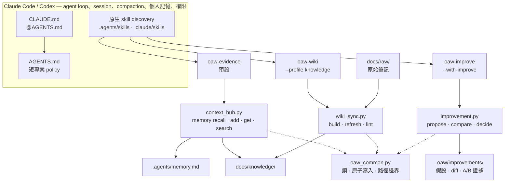
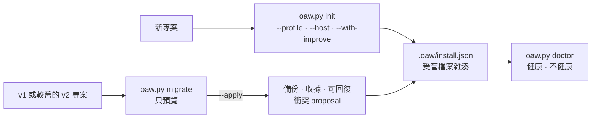

# 🍲 O-ALL-WANT (OAW) Framework

<div align="center">

[](https://opensource.org/licenses/MIT)
[](https://github.com/lihowfun/O-ALL-WANT/stargazers)
[](https://github.com/lihowfun/O-ALL-WANT/commits/main)
[](https://github.com/lihowfun/O-ALL-WANT/issues)
[](https://github.com/lihowfun/O-ALL-WANT/actions/workflows/test.yml)

</div>

<div align="center">
  <a href="README.md">English</a> |
  <a href="README.zh.md">中文</a> |
  <a href="https://www.readme-i18n.com/lihowfun/O-ALL-WANT?lang=ja">日本語</a> |
  <a href="https://www.readme-i18n.com/lihowfun/O-ALL-WANT?lang=ko">한국어</a> |
  <a href="https://www.readme-i18n.com/lihowfun/O-ALL-WANT?lang=de">Deutsch</a> |
  <a href="https://www.readme-i18n.com/lihowfun/O-ALL-WANT?lang=fr">Français</a> |
  <a href="https://www.readme-i18n.com/lihowfun/O-ALL-WANT?lang=es">Español</a>
</div>

> Why choose when you can have it all?
> 「小孩子才做選擇，身為一個開發者，我～全、都、要！」

<p align="center">
  
</p>

> **v2.0.0 目前是 PR 中的提案版本，尚未發布 release。** [升級指南](docs/UPGRADING.md) · [CLI](docs/CLI_Reference.md) · [執行計畫](docs/plans/v2.0.0-execution.md)

## 20 秒看懂

OAW 只補 agent 從程式碼看不出來的東西，其他都交給 agent 本身：

- **專案證據**：決策原因、外部限制、實驗結果。任務需要時連同來源一起找回來。
- **原生 skills**：標準 `SKILL.md` 套件，同一份來源同時裝給 Claude Code 和 Codex。
- **選配 wiki**：把原始筆記編譯成可搜尋的知識頁。
- **有證據才改進**：任何規則或 skill 的改動，都要有具體 diff 和對照組 A/B 證據，由你決定是否採用。

agent loop、session、compaction、個人記憶、權限和 skill discovery 都由 Claude Code 或 Codex 負責。

```bash
git clone https://github.com/lihowfun/O-ALL-WANT.git OAW
python3 OAW/scripts/oaw.py init --target /path/to/project --host both
python3 OAW/scripts/oaw.py doctor --target /path/to/project
```

## 為什麼會在這?

這是一套專為「極度貪心」的 agentic coding 使用者打造的專案裝甲（harness）。

如果你也是那種會在不同 AI 平台間橫跳、腦中只想著怎麼把每一顆高級 token 榨到最大的開發者，那你大概很熟悉這種心碎：對話一長，agent 開始失憶；session 一換，對專案的掌握度瞬間歸零。你還沒寫到真正重要的邏輯，就先被迫花一大堆 token 重新解釋背景，最後看到那句讓人崩潰的 `You have hit your limit`。

如果你也受夠了這種資源內耗，OAW 就是我替這件事做出來的解藥。

這專案是我在數個燃燒肝臟的下班夜晚，瘋狂奴役 Claude Code 與 Codex，然後把 Context Hub、MemPalace、Karpathy-style LLM Wiki、thin harness / fat skills 這些大神 github repo 或文章精華全摻在一起煮的撒尿牛丸鍋。

**v2 是同一鍋，但徹底洗過一次鍋。** 現在 Claude Code 和 Codex 自己就會熬高湯：session、compaction、記憶和 skill discovery 都是原生的。所以 OAW 不再重煮一次，只加 host 不知道的料：這個專案為什麼長這樣，以及任何「改進」在留下來之前都要先拿出證據。

目的還是只有一個：**讓昂貴 token 用在真的值得的推理與輸出上**，而不是浪費在「重跑已完成的內容」或「重新解釋專案架構」上。

> **只需要其中一樣?** 請直接 fork 對應的原作（列在最下面的 Source lineage）。但如果你跟我一樣全都要，這鍋就是煮給你吃的。想快速比較定位可以看：[OAW 和其他工具差在哪](docs/COMPARISON.md)。

---

## 🍲 這版鍋裡有什麼？（v2.0.0）

| | 料 | 在 v2 做什麼 | 怎麼拿到 |
|---|---|---|---|
| 🧭 | **原生優先的核心** | 短短的 `AGENTS.md`，只寫不明顯的限制和真正的驗證指令；`CLAUDE.md` 只負責引用它。沒有 router，也沒有強制開場閱讀 | 預設 |
| 🧾 | **證據回想（Context Hub）** | `context_hub.py memory recall` 回傳有上限的 JSON 或文字，附來源位置、截斷標記和續讀 cursor。筆記是要對照現行程式碼檢查的證據，不會蓋過你的指令 | 預設 |
| 🧩 | **原生 skills** | 三個標準 `SKILL.md` 套件。`--host codex\|claude\|both` 從同一份來源產生 `.agents/skills` 和／或 `.claude/skills` | 預設裝 `oaw-evidence`，其他見下 |
| 📚 | **LLM Wiki** | `wiki_sync.py` 把 `docs/raw/` 確定性地編譯成 `docs/knowledge/`，並檢查連結、metadata 和新鮮度。它是 renderer，不是 LLM 摘要器 | `--profile knowledge` |
| 🔬 | **有證據的自我改進** | 假設＋具體 diff → 固定案例的 baseline／candidate 對照 → 你明確採用或拒絕。品質退步、證據缺失或被改動都會擋下；永遠不會自動套用 | `--with-improve` |
| 🛟 | **安全的安裝與升級** | `init` 保護既有內容；`migrate` 預設只預覽，`--apply` 會留下備份、收據、可回復，衝突變成 proposal；`doctor` 回報健康狀態 | 一律 |
| 🔒 | **安全寫入** | 加鎖的讀改寫、原子替換，拒絕 symlink／junction 和路徑逃逸 | 一律 |
| 📉 | **精簡輸出** | `search --compact` 和 `--max-chars` 上限讓工具輸出保持精簡 | 預設 |
| ✅ | **證明閘門** | `harness_check.py`：8 組檢查，要求所有測試模組都在、達到最低測試數、零 skip；CI 跑 Ubuntu、macOS、Windows × Python 3.10、3.13 | 本 repo |

### 🥄 這版從鍋裡撈掉的料

| 撈掉 | 原因 |
|---|---|
| `CLAUDE.md` Master Router 和各條 lane | 讀什麼由 host 自己決定，原生 skill 也由 host 自己發現 |
| 佔位用的 `AI_CONTEXT.md`、`ROADMAP.md`、根目錄 `VERSION.json` | 狀態鏡像很容易過期。不再建立；你已經有的檔案會保留 |
| `do_not_rerun` 狀態機 | 歷史筆記是歷史，不是永久的執行限制 |
| 平鋪、靠關鍵字觸發的 skills 和「Skills-First」調度 | 換成原生 `SKILL.md` discovery |
| 強制寫記憶、收尾報告、skill review 提醒 | 個人記憶已經是原生功能；只記錄可重用的專案證據 |
| Copilot／Cursor／Windsurf／Gemini 指向檔 | v2 以 Claude Code 和 Codex 為目標；未改動的舊 adapter 會在 migrate 時移進備份 |
| 「startup context 省 86–87%」的標語 | 那是 v1「挑選 Markdown」對「全部讀進來」的比較，保留當歷史，不是 v2 的 benchmark |

---

## 🏗️ 架構

**執行時**：agent 由 host 負責。OAW 提供一份短 policy、三個原生 skill，以及讀寫專案檔案的小型標準函式庫工具。



**安裝與升級時**：每一次寫入都會先預覽、留備份，或直接拒絕。



### 🛡️ 三大支柱（v2）

| 支柱 | 實作 | 解決的問題 |
|---|---|---|
| **原生優先** | 短 `AGENTS.md`；skill 需要時才載入；不另起一套 agent runtime | 兩套系統搶 session、記憶和 startup context |
| **證據，不是指令** | 回想時附來源和版本；筆記要對照現行程式碼檢查；取回的文字不會蓋過使用者 | 過期或被注入的筆記把 agent 帶偏 |
| **先證明再採用** | 改進要有 diff 和對照組 A/B 證據；安裝器變更要過 gate；沒有任何東西會自己套用 | 所謂「自我改進」只是一直疊規則 |

---

## 🔁 原生 host 之上，OAW 還多做什麼

v1 誕生的時代，coding agent 每換一個 session 就全部忘光。現在 Claude Code 和 Codex 原生就會讀專案規則檔、有自己的記憶，也會自己發現 skill。所以誠實的比較不是「有沒有 OAW」，而是「只有原生 host」對上「原生 host 加 OAW」。

| 當 agent 需要… | 只有原生 host | 原生 host + OAW v2 |
|---|---|---|
| 專案規則和真正的驗證指令 | 各讀各的規則檔（Codex 讀 `AGENTS.md`、Claude Code 讀 `CLAUDE.md`） | 一份短短的 `AGENTS.md` 兩個 host 共用，`CLAUDE.md` 只負責引用它 |
| 你個人的跨 session 偏好 | host 自己的記憶（有啟用的話） | 交給 host，OAW 刻意不重做 |
| 專案某個決策的來龍去脈 | 個人記憶或對話紀錄：不在 repo 裡，團隊和另一個 host 都看不到 | 存在 repo 裡的專案證據，附來源、版本和適用範圍；`memory recall` 有上限地取回 |
| 判斷一則舊筆記能不能信 | 看 agent 自己判斷 | evidence skill 明確要求對照現行程式碼，並標記已被取代的結論 |
| 兩個 host 用同一套 skill | 每個 host 各放一份、各自維護 | 同一份來源產生 `.agents/skills` 和 `.claude/skills`，`doctor` 會檢查 |
| 新增規則或 skill | 誰寫了就加 | 選配 `oaw-improve`：要有 diff、對照組 A/B 證據，並經過你明確同意 |

> v2 沒有宣稱任何 token 節省數字。Claude Code／Codex 的實機 A/B 和實際 skill discovery 都還沒量測；見[本機驗證紀錄](docs/validation/v2.0.0-local.md)。

---

## ⚡ 快速上手

需要 Python 3.10+，runtime 只用標準函式庫。在 OAW checkout 執行：

```bash
python3 scripts/oaw.py init --target /path/to/project            # 裝給 Codex（預設）
python3 scripts/oaw.py init --target /path/to/project --host both
python3 scripts/oaw.py doctor --target /path/to/project
```

預設只安裝五個 framework 檔：短 `AGENTS.md`、Claude 相容 import、一個 evidence skill、Context Hub 和共用 helper。不建立記憶檔、不塞佔位架構，也沒有強制的 session 流程。遇到既有的不同內容會保留。

選配功能可以在已安裝的專案上累加：

```bash
python3 scripts/oaw.py init --target /path/to/project --profile knowledge   # wiki renderer + wiki skill
python3 scripts/oaw.py init --target /path/to/project --with-improve        # 有證據的改進流程
```

Bash 捷徑：在目標專案執行 `bash /path/to/O-ALL-WANT/install.sh`。範例：[最小安裝](example/minimal-project/) · [knowledge 與 improvement](example/public-hybrid-demo/)

### 📂 升級既有的 OAW 專案

```bash
python3 scripts/oaw.py migrate --target /path/to/project           # 只預覽
python3 scripts/oaw.py migrate --target /path/to/project --apply   # 備份 + proposal
```

可識別且未改動的 framework 檔會直接更新。客製的 policy 和 skill 會變成 proposal，不會被覆寫。記憶、knowledge、原始筆記、`AI_CONTEXT.md`、`ROADMAP.md` 和根目錄 `VERSION.json` 都歸你所有。proposal 處理完之前，不要把升級當成完成。見 [UPGRADING](docs/UPGRADING.md)。

### 🔌 Host 對應

| Host | Policy 檔 | Skills 目錄 |
|---|---|---|
| **OpenAI Codex** | `AGENTS.md` | `.agents/skills/`（`--host codex`，預設） |
| **Claude Code** | `CLAUDE.md` → `@AGENTS.md` | `.claude/skills/`（`--host claude`） |
| 兩者 | 同一份 policy | 從同一份來源產生兩個目錄（`--host both`） |

OAW 不會偷改 host 設定。`doctor` 會把「支援」和「已啟用」分開回報。本機 schema 測試不能證明兩個 host 實際載入得到 skill。見 [Skill Guide](docs/Skill_Guide.md)。

---

## 🔧 直接下指令

在已安裝的專案執行：

| 指令 | 用途 |
|---|---|
| `python3 scripts/context_hub.py memory recall "快取決策" --json --max-chars 12000` | 有上限的回想，附來源和續讀 |
| `python3 scripts/context_hub.py memory add "[DECISION] 保留本機快取 — 證據：docs/experiment.md"` | 記錄可長期使用的證據 |
| `python3 scripts/context_hub.py get Cache_Decision` | 讀一頁知識頁 |
| `python3 scripts/context_hub.py search "keyword" --compact` | 一行一個主題的搜尋 |
| `python3 scripts/wiki_sync.py refresh Topic` · `lint` | 編譯和檢查 wiki（knowledge profile） |
| `python3 scripts/improvement.py --help` | 提案、比較、決定改進（`--with-improve`） |

完整清單：[CLI Reference](docs/CLI_Reference.md) · [Self-improvement 指南](docs/SELF_IMPROVEMENT.md)

---

## 🐕 Self-Hosting：repo 自己是自己的第一個用戶

根目錄的 `AGENTS.md` 和 `CLAUDE.md` 是 OAW 團隊自己在用的版本，不是你安裝的模板。可安裝的版本在 `templates/`，產生的範例會和安裝器逐位元組比對。

```bash
python3 scripts/harness_check.py
python3 scripts/sync_examples.py --write
```

見 [CONTRIBUTING](CONTRIBUTING.md) 和 [CHANGELOG](CHANGELOG.md)。

---

## Source lineage（站在巨人肩膀上）

確切版本與使用狀態見 [v2.0.0 來源版本表](docs/releases/2.0.0-sources.md)。
EGM **0.1.0**、commit [`f0ba151b252c9abf1318d9fe857a43265d06de89`](https://github.com/google/elephant-goldfish-model/tree/f0ba151b252c9abf1318d9fe857a43265d06de89)
已做設計審查用途的靜態評估；OAW 尚未內建或安裝 EGM。
採用、替換與淘汰建議見 [review](docs/reviews/2026-10-29-pr4-egm.md)。

**v2 保留的歷史概念來源**（當時未記錄上游版本；以下是閱讀入口，並非固定版本的 runtime 相依）

- 📉 **[andrewyng/context-hub](https://github.com/andrewyng/context-hub)** — `context_hub.py` 的架構：可搜尋的知識、annotation、回想
- 🧠 **[MemPalace](https://github.com/MemPalace/mempalace)** — `.agents/memory.md` 的標籤式條目格式
- 📚 **[Karpathy-style LLM Wiki](https://gist.github.com/karpathy/442a6bf555914893e9891c11519de94f)** — `docs/raw/` → `docs/knowledge/` 背後「原始筆記和編譯後 wiki 分開」的想法
- ⚡ **[thin harness / fat skills (Garry Tan)](https://x.com/garrytan/status/2042925773300908103)** — policy 保持精簡、工作推進 skills，現在變成原生 `SKILL.md` 套件
- 🤝 **[RTK (rtk-ai/rtk)](https://github.com/rtk-ai/rtk)** — 縮短工具輸出的概念參考（`--compact`）；OAW 沒有內建 RTK
- 🧰 **[Pi](https://github.com/earendil-works/pi)**、**[Deep Agents](https://docs.langchain.com/oss/python/deepagents/overview)**、**[Hermes](https://hermes-agent.nousresearch.com/docs/)** — 工具輸出上限和生命週期邊界；沒有內嵌它們的 runtime

**v2 不再使用的**

- 🔄 **[self-improving-agent / ClawHub](https://clawhub.ai/skills/self-improver)** — v1 的 `do_not_rerun`、session 收尾報告和失敗紀錄來自這個模式；v2 改成「先證明再採用」的改進流程
- 🧠 MemPalace 的收尾紀律 — 隨著強制 session 流程一起移除，只保留它的條目格式

延伸閱讀：[Architecture Origins](docs/Architecture_Origins.md) · [Design Principles](docs/Design_Principles.md)

## License

MIT License.
