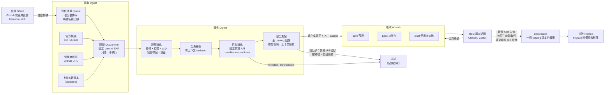

# OAW Skill Catalog 執行計畫：攝取、消化、吸收、排泄

狀態：P0 完成，待決事項已於 2026-10-29 決定（見文末）。目標版本 v2.1.0（proposed）。尚未實作。前置條件是 [PR #4](https://github.com/lihowfun/O-ALL-WANT/pull/4)（v2.0.0）先 merge，再從 `main` 開 `feat/skill-catalog` 分支。

## 目標

把 OAW 從「三個自帶 skill」升級成 **skill 大全（catalog）**，並讓它能持續新陳代謝：

0. **覓食**：定期搜尋 GitHub 上快速成長的 harness 和 skill（例如 EGM），找到就自動排進消化清單。
1. **攝取**新的 skill：覓食找到的、官方挑選的，或使用者自帶的 GitHub skill 都可以。
2. 用固定的測試來**消化**，判斷它在目前的 Claude Code / Codex 版本上是否真的有幫助，而且**和既有的 skill 整合得好**。不是所有食物都好吃：會讓 OAW「拉肚子」的（讓其他 skill 退步、互相搶觸發、撐爆上下文）一律排掉。Catalog 不是越大越好，每多一個 skill 都要證明它值得佔那個位置。
3. 通過的 skill 被**吸收**進對應層級：預設、加強包或使用者本地。
4. 過時、被原生功能取代、或在新版 host 上失效的 skill 被**排泄**（淘汰），並留下證據。
5. 一般使用者拿到的是「預設環境」：我們調好、驗證過的最佳 skill 組合。想加強某方面的人可以加選加強包，或把自己找的 GitHub skill 丟進同一套流程。

第一個實際案例是 [google/elephant-goldfish-model](https://github.com/google/elephant-goldfish-model)（EGM）。

## 核心流程（最重要）



### 生命週期狀態

| 狀態 | 意義 | 誰能推進到下一步 |
|---|---|---|
| `queued` | 覓食找到、或人工加入消化清單，尚未下載 | 自動：依排序和每週名額抓進隔離區 |
| `quarantined` | 已抓下固定版本，尚未檢查。不會安裝到任何專案 | 自動：`catalog.py digest` 的靜態檢查 |
| `digested` | 靜態檢查全過，金魚審查已記錄 | 跑完行為情境 A/B |
| `eligible` | A/B 的每一次比較都是 eligible（沿用 `improvement.py` 的閘門） | 人工 `absorb`，必須寫理由 |
| `absorbed` | 進入 `core`、`pack:<名稱>` 或 `local` 層級 | 版本矩陣持續驗證 |
| `deprecated` | 觸發淘汰條件，保留一個 catalog 版本當緩衝 | 人工 `retire` |
| `retired` | 已淘汰。`migrate` 會備份後移除已安裝的副本 | 不可逆，要回來必須重新攝取 |
| `rejected` | 消化失敗、整合時拉肚子，或人工拒絕；症狀記錄在證據裡 | 上游出新版本時重新攝取 |

**自動化的界線**：只做檢查、不花模型額度、不改變任何使用者環境的步驟可以自動執行，包括覓食 → 排隊 → 抓進隔離區 → 靜態消化。下載的內容一律不執行。之後的步驟都由人啟動：行為 A/B 和整合測試要花帳號額度，吸收、淘汰、安裝則會改變使用者拿到的環境。任何 skill 都**不會自動安裝或套用**。這延續 v2 的原則。

### 每一關的閘門

| 關卡 | 檢查內容 | 不通過時 |
|---|---|---|
| 攝取 | 固定到 commit SHA。拒絕 symlink、repo 外路徑、二進位執行檔與過大的 repo。記錄檔案清單和雜湊 | 不建立紀錄 |
| 授權 | 偵測 LICENSE。必須是允許再散布的授權（Apache-2.0、MIT、BSD 等）。Apache-2.0 要保留 LICENSE/NOTICE，修改處要標示 | `rejected` |
| 結構 | `SKILL.md` frontmatter（name ≤64、description ≤1024），本文 ≤ 24,000 bytes（取各 host 中最嚴的上限），引用的檔案必須存在 | `rejected` |
| 安全標記 | 掃描 hooks、自動核准權限、`curl \| sh`、要求忽略既有指示、擴權或外傳資料等字樣。**只標記，交給人判斷**，因為 EGM 的實測顯示 "bypass" 這類字幾乎都是正常的流程用語 | 有未處理的標記就不能 absorb |
| 重疊 | 同一個 `capability` 槽位是否已有預設 skill。另外判斷 host 是否已經原生具備這項能力（native-first） | 只能進 pack 或 local，不能進 core |
| 金魚審查 | 借用 EGM 的做法：一個沒有對話上下文的 reviewer，只讀 skill 套件和評分標準，指出模糊、越權、重複之處 | 發現的問題必須逐條處理或明確接受 |
| 行為 A/B | 固定情境（沿用 EGM `test_scenarios.yaml` 的 required/forbidden pattern 斷言），baseline（不裝）對 candidate（裝），同 host、同版本、同模型、同 repeat 數 | `rejected` 或 `inconclusive` |
| 整合（拉肚子檢查） | 裝上新 skill 後跑**整個 catalog** 的回歸套件；檢查觸發衝突和啟動時的上下文預算（見「不是越多越好」） | 任何既有 skill 退步，或超出預算，就判定拉肚子 → `rejected` |
| 進入 core 的額外門檻 | Claude 和 Codex 的**目前版本**都要有 eligible 證據；預設評估套件不能退步；token 預算不能超標 | 只能進 pack |

## 覓食：找出快速成長的 harness

`catalog.py scout` 會搜尋 GitHub，把值得一試的 harness 和 skill 排進消化清單。熱門程度**只用來決定排隊順序，不會影響能不能被吸收**。能不能吸收只看測試結果。

### 搜尋範圍

- **主題標籤**：`claude-code`、`codex`、`agent-skills`、`claude-skills`、`ai-agents` 等，清單放在 `catalog/scout/config.json`，可以調整。
- **特徵檔案**：repo 裡有 `SKILL.md`、`.claude-plugin/plugin.json`、`.codex-plugin/plugin.json` 或 `AGENTS.md`。
- **成長速度**：GitHub API 沒有直接提供 star 成長曲線，所以每次覓食都把 star 數記到 `catalog/scout/snapshots.jsonl`，用兩次快照的差值算出每週成長。第一次執行還沒有快照，先用「star 數 ÷ repo 存在天數」暫代。

### 硬性過濾（不符合就不排隊）

- 必須有允許再散布的授權。
- 不能是封存（archived）的 repo，最近 90 天內要有 commit。
- 至少要有一個 skill 或 plugin 的 manifest。
- repo 大小要在上限內。
- 已經在 catalog 裡、或已經被 `rejected` 且上游沒有新 commit 的，跳過。
- star 數暴增但 commit、貢獻者、issue 都很少的 repo，標記成「可能刷星」並降低排序，交給人看。

### 排序與名額

- 分數 = 成長速度 × 和現有 capability 槽位的相關度 × 維護活躍度，計算方式和權重寫在 config 裡。
- **每週名額上限**（預設 5 個）。消化清單塞太多也是拉肚子；名額外的候選留在 `catalog/scout/<日期>.json`，等下一輪。
- 每週排程的 GitHub Action 執行覓食和靜態消化，然後開一個 issue 列出新排隊的項目和靜態消化結果。它不開 PR，也不改 catalog 的內容。
- GitHub token 只從環境變數讀取（CI 用內建的 `GITHUB_TOKEN`），不寫進任何檔案。

## 不是越多越好：整合測試與拉肚子判定

單一 skill 的 A/B 通過，只代表它「單獨吃」沒問題。吸收前還要確認它和整個 catalog 一起運作時不會出事。

### 拉肚子的症狀

| 症狀 | 怎麼量測 | 判定 |
|---|---|---|
| 讓其他 skill 退步 | 裝上新 skill 後，跑 core 和所有已吸收 pack 的完整回歸套件 | 任何既有情境比原本差（超過預先寫死的容許誤差） |
| 搶觸發 | 觸發測試集：一組請求，每個請求都事先寫好「應該觸發哪個 skill、哪些不該觸發」，量測觸發錯誤的比例 | 錯誤率高於加入前 |
| 撐爆上下文 | 統計啟動時載入的 skill metadata（name 和 description）總 token 數 | 超過該 profile 的預算 |
| 指示互相矛盾 | 金魚審查同時讀新 skill、`AGENTS.md` 和同槽位的其他 skill，找出互相衝突的指示 | 有未解決的衝突 |

EGM 的 7 個 skill 都只能手動呼叫，理論上不會搶觸發。這一點仍然要用觸發測試集實測確認。

### 預算

- **core**：skill 數量和啟動 metadata 的 token 數都有上限，在 P5 依實測決定，並寫進 `catalog/releases/<ver>.json`。
- **每個 capability 槽位只有一個預設 skill**，同類型的其他 skill 只能進 pack。
- **pack**：每個 pack 有自己的預算。使用者同時選多個 pack 時，安裝器會先檢查加總後的預算，超過就提醒使用者。

### 消化成養分，而不是原樣吞下

一個新 harness 可以用三種方式進入 OAW，依序優先考慮：

1. **吸收方法**：把它的好做法改進到既有的 OAW skill 或流程裡，並在版本引用中註明來源。例如 EGM 的金魚審查變成我們消化流程的一關。這種方式不會增加 skill 數量。
2. **原樣放進 pack**：它的功能 OAW 沒有，而且整合測試沒有拉肚子。
3. **排掉**：其他情況，記錄症狀和理由。

### 留一法（定期瘦身）

每個 catalog 版本發布前，對 core 裡的每個 skill 做一次「拿掉它」的比較。如果拿掉後的結果齊平或更好，代表它已經沒有貢獻，就列入淘汰候選（排泄條件 5）。這是用來確保 catalog 不會只增不減。

## 測試標準：齊平是底線，贏了才叫進化

OAW 吃進一個 skill 之後，必須至少和「直接用那個 skill」一樣好。這是齊平底線，每次迭代更新都不能低於它。只有在同樣條件下明確贏過對方，才能宣稱 OAW「進化」了。

### 三種判定

| 判定 | 條件 | 可以做什麼 |
|---|---|---|
| **進化** | 沒有任何退步，而且品質通過數更多，或品質相同但 token/時間省下至少 5% | 可以發布，release notes 可以寫「改善」並附證據 |
| **齊平** | 沒有任何退步，品質通過數相同，資源用量在容許範圍內 | 可以當成迭代更新發布，但 release notes 必須寫「齊平，未宣稱改善」 |
| **退步** | 任何一項斷言退步、必要檢查失敗，或資源超過容許範圍 | 不能發布、不能吸收 |

這三種判定對應到 `improvement.py` 現有的 `eligible`、`inconclusive`、`rejected`。P4 要新增一個「齊平可發布」的接受模式。現在的 `decide accept` 只接受 `eligible`，這個規則仍然適用於「新 skill 進 core」：如果不能贏過不裝它的情況，就沒有理由放進預設。

### 對手與受測組合（以 EGM 為例）

| 組合 | 內容 | 用途 |
|---|---|---|
| A 原生 | 只有 host 本身 | 確認 EGM 對原生真的有幫助；如果連原生都贏不了，EGM 根本不該被吸收 |
| B 對手 | 原生加上 EGM 官方 plugin（固定 `f0ba151`） | 要打的對象 |
| C OAW | OAW 的 core 預設加上 `design-review` pack（同一個 EGM 版本） | 必須達到 **C ≥ B（齊平）**，才能證明 OAW 的其他部分沒有干擾 EGM，例如觸發混淆或上下文膨脹 |

只有 **C > B** 時，才能宣稱 OAW 吃了 EGM 之後有進化。OAW 可能贏的地方要事先寫明並量測，不能事後挑選。目前的假設有兩個：
- `oaw-evidence` 讓 Elephant 起草時能引用專案過去的決定。
- catalog 消化流程本身帶來的改進。

### 測試案例

1. **EGM 自帶的 30 個情境**：用 required/forbidden pattern 斷言，三組都跑。這是對手的主場，用來檢查齊平。
2. **OAW 的設計任務**：在有專案歷史的 fixture repo 上做設計審查。例如某個設計必須遵守先前記錄的決定，看起草和審查能不能發現衝突。這是 OAW 可能贏的地方，用來檢查進化。
3. **資源**：每次執行都記錄 token、時間、子 agent 數量，並標明數字是操作者回報的，不是模型認證的量測。

### 比較規則（P4 實作，跑之前就固定）

- 每個情境在每一組至少跑 **5 次**，同一個 host、同版本、同模型、同 effort、同 repo 狀態。依決定 2，Claude Code 和 Codex 的目前版本**都要跑**。
- 比較單位是「情境 × 斷言」在 N 次中的**通過次數**，不是第 i 次對第 i 次。這是為了避免實機雜訊被誤判成退步或進步。
- **容許誤差在跑之前寫進評估規格並記錄雜湊**：deterministic fixture 的容許誤差是 0；實機預設是 5 次中 1 次。看到結果後不能再改。這一條也順便堵住審查時發現的 P2 問題：評估規格在看到結果後仍可修改。
- 任何「情境 × 斷言」的通過次數比對手少超過容許誤差，就判定為退步。總通過次數也不能少於對手。
- 沒有實機證據的 host，只能記成 `untested`，不能拿 fixture 結果代替。

### 版本棘輪

每一個 catalog 版本 N 都要和版本 N−1 在完整回歸套件上比較，結果至少要齊平才能發布。被淘汰的 skill 不列入比較，但必須在 release notes 說明拿掉的是什麼、為什麼拿掉（見下一節）。

## 版本引用與移除說明

每一個版本只引用**這個版本實際用到**的上游內容；沒有用到的，要說明這個版本拿掉了什麼、或為什麼沒採用。

### 紀錄格式

`catalog/releases/<ver>.json` 新增兩個欄位：

- `uses`：這個版本實際用到的每一項上游內容，記錄來源 repo、固定 SHA、授權、用到的檔案或方法，以及 OAW 裡對應的位置（`used_in`，必須是存在的檔案或 pack）。
- `removed`：上一個版本有、這個版本沒有的項目，加上評估過但不採用的上游內容。每一項都要附理由和證據連結。

發布時從這個檔案產生 `docs/releases/<ver>.md`，分成「本版引用」和「本版移除/未採用」兩段，CHANGELOG 只放連結。

### Gate 檢查

- core 或 pack 中的每個項目，都要在 `uses` 裡有對應的引用。
- `uses` 中的每一項，`used_in` 都必須真的存在。用不到的東西不能拿來充數引用。
- 上一版有、這一版沒有的項目，必須出現在 `removed` 而且有理由，否則 gate 失敗。
- 複製或改寫自 Apache-2.0 的檔案（例如轉成 JSON 的 EGM 情境）要附上 LICENSE、NOTICE，並標示修改處。

### EGM 在 v2.1.0 的預定引用

| 類別 | 項目 | 用在 OAW 哪裡 |
|---|---|---|
| 使用 | 7 個 skill、9 個 reviewer persona、文件標準（透過官方 plugin 安裝） | `design-review` pack |
| 使用 | 30 個 `test_scenarios.yaml` 情境（轉成 JSON，附授權） | catalog 行為消化的回歸套件 |
| 採用方法 | 金魚審查：零上下文 reviewer | catalog 消化流程的一個關卡 |
| 採用方法 | required/forbidden pattern 斷言格式 | catalog 情境 schema |
| 採用方法 | 24,000 bytes 本文上限 | `validate_skills.py` |
| 採用方法 | Harness 測試紀錄表 | `catalog/hosts.json` |
| 採用方法 | 打包 allowlist | catalog 打包和安裝檢查 |
| 採用方法 | README 版面結構、skill 圖示規格（24×24、雙色、含 title） | `README.md`、`README.zh.md`、各 skill 的 `assets/icon.svg` |
| 未採用 | `site/`（Astro 網站）、Antigravity 散布、`scripts/pack_plugin.py`、`prepare_release.py`、CI workflows、圖示 | 和 OAW 的 catalog 用途無關，或已由官方 plugin 負責；每一項都要在 release notes 寫一行理由 |

這張表是預定的。實際內容以 P7 的測試結果為準：沒有證據支持的項目，要移到「未採用」。

## 三種使用方式

| 使用者 | 指令（草案） | 拿到什麼 |
|---|---|---|
| 一般使用者 | `oaw.py init` | `core` 預設環境：目前 catalog 版本中，在兩個 host 都驗證過的最佳組合 |
| 想加強某方面 | `oaw.py init --pack design-review`，或互動式勾選 | 預設環境加上指定的加強包 |
| 自帶 GitHub skill | `catalog.py ingest https://github.com/x/y --ref <sha> --local` | 在自己專案的 `.oaw/catalog/` 走完同一套消化流程，通過且 accept 後才裝進 `local` 層級 |

「最佳參數」必須有證據支撐：預設組合的每一次變更都要經過預設評估套件的 A/B，並記錄在 catalog 版本檔裡。

## 與時俱進：Host 版本矩陣

- `catalog/hosts.json` 記錄每個 skill 在每個 host 版本上的狀態：`pass`、`fail`、`untested`、`native-superseded`，並附證據路徑和日期。格式參考 EGM 的 Harness Test Record。
- **定期檢查（只報告，不改 code）**：一個每週排程的 GitHub Action 查詢 Claude Code / Codex 的最新版本。出現未驗證的新版本時開 issue，跑不需要憑證的靜態檢查，並標記矩陣中的 `untested`。
- **實機驗證（選擇性）**：需要帳號和額度，比照 EGM 的 `EGM_CLAUDE_LIVE=1`，由人在本機執行，結果寫回矩陣。CI 的綠燈不能當成實機通過。
- **上游更新**：`catalog.py outdated` 比對固定的 SHA 和上游最新 commit（需要網路，必須明確呼叫）。上游有變動就產生新的 `quarantined` 版本，重新消化。不會自動升級。

### 淘汰（排泄）條件

1. **被原生功能取代**：host 新版本內建了同樣的能力，而且 A/B 顯示這個 skill 已經沒有額外好處。
2. **連續兩個受支援的 host 版本都失效**。
3. **被同槽位中證據更好的 skill 取代**。
4. **上游授權變更、repo 封存，或出現安全問題**：立即退回 `quarantined`，不等緩衝期。
5. **長期沒有可量測的好處**：發布前的留一法比較顯示，拿掉它的結果齊平或更好。

淘汰流程沿用 v2 `migrate` 的 retire 機制：先備份、留下收據、使用者自訂的版本不會被刪。

## Catalog 資料結構（草案）

```text
catalog/
  registry.json          # 每個 skill：id、來源 URL、固定 SHA、授權、capability、層級、狀態、各 host 狀態
  releases/<ver>.json    # 某個 catalog 版本的 core 與 pack 組成，加上檔案雜湊
  hosts.json             # host 版本矩陣
  packs/<name>.json      # 加強包定義
  evidence/<id>/...      # 消化報告、金魚審查、A/B 比較（不放帳號資料或原始 transcript）
  vendor/<source>@<sha>/ # 需要隨 OAW 散布的第三方 skill，附 LICENSE/NOTICE
```

只用標準函式庫的 Python 不能讀 YAML。EGM 的 `test_scenarios.yaml` 在攝取時會一次性轉成 JSON，同時記錄原始檔的雜湊與來源。

## EGM 試吃：已實測的消化預覽

來源：`f0ba151`（2026-10-28），Apache-2.0，225 個檔案。我們已在隔離目錄讀過內容，沒有執行任何檔案。

| 項目 | 結果 | 對 catalog 的意義 |
|---|---|---|
| Skill 數量 | 7 個（brainstorm、draft、review、review-loop、resolve、bootstrap、drift-report），加上 9 個 reviewer persona 和文件標準 | 必須整套一起裝，不能只挑單一 skill |
| 呼叫方式 | 7 個都是 `disable-model-invocation: true`，只能手動呼叫 | 不會干擾原生的自動觸發，適合當 pack |
| 本文大小 | 2,807 到 23,610 bytes。bootstrap 離 24,000 的上限只差 390 bytes | 結構關卡會通過，但要列入監控 |
| 測試情境 | 共 30 個情境，用 required/forbidden pattern 斷言 | 可直接轉成行為消化的固定案例 |
| 安全標記 | 5 處 "bypass"，全是正常的流程用語 | 證明安全掃描必須是「標記後人工判斷」 |
| Host 需求 | 需要能開新 subagent 的 session；作者驗證過 Claude Code 2.1.308、Codex 0.163.0 | 寫進 host 版本矩陣的初始值 |
| 和 OAW 重疊 | drift-report 和 oaw-wiki 的新鮮度檢查部分重疊（前者比對文件與程式碼，後者比對 raw 與 wiki）；bootstrap 和專案文件初始化部分重疊；和 evidence、improve 不重疊 | 放進 `design-review` pack，不進 core |
| 散布方式 | 官方已提供 Claude/Codex plugin 安裝指令 | 已決定：OAW 只記錄固定版本和證據，透過官方 plugin 安裝，不 fork（決定 1） |

### EGM 快速通道（2026-10-29 決定加速）

EGM 的實測提前到 P1–P5 之前，不等 catalog 整套蓋完。證據先放在 `evals/egm-pilot/`，等 P1–P5 完成後再匯入 catalog。

**可行性（已確認，沒有花模型額度）**
- Claude Code 2.1.309 可以無頭執行，支援 `--plugin-dir`（直接載入 EGM，不必安裝到使用者設定）、`--max-budget-usd`、`--output-format`。
- 這台機器**沒有 Codex CLI**。在你同意安裝並登入之前，Codex 一律記成 `untested`。
- EGM 沒有 hooks，載入它只是把 markdown 指示交給模型，不會執行它的程式碼。

**測試要分兩套，因為 EGM 的 30 個情境量的是「有沒有照 EGM 流程走」，不是設計品質**

| 測試套 | 內容 | 能證明什麼 |
|---|---|---|
| 流程套 | EGM 的 30 個情境（29 個單輪、1 個兩輪，全是文字斷言） | **C 對 B 是否齊平**：OAW 有沒有干擾 EGM。B 贏 A 是必然的，不能當成品質證據 |
| 結果套 | 在設計文件中預先埋好已知缺陷：缺 SLO、未定義術語、模糊任務、內部矛盾，外加一個「和專案過去記錄的決策衝突」的缺陷。量測三組各抓到幾個 | EGM 是否比原生更會抓缺陷（B 對 A）；OAW+EGM 是否更好（C 對 B）。決策衝突那題是 OAW 證據回想可能贏的地方，因為 EGM 的金魚審查員刻意不看上下文 |

**階段**

| 階段 | 內容 | 花額度 |
|---|---|---|
| F0 | 建 `evals/egm-pilot/`：預先登記的評估規格（容許誤差、repeat 數，事先記錄雜湊）、三組的 fixture repo（C 組裝 OAW `--host claude`）、埋缺陷的設計文件、無頭執行腳本（含不呼叫模型的 dry-run） | 否 |
| F1 | 校準：3 個情境 × 3 組 × 1 次，每次都設花費上限，量測每次執行的時間和 token，推算完整跑一輪的成本。**2026-10-29 暫停**：唯一一次嘗試在登入階段就失敗（CLI 登入過期），沒有呼叫模型、花費 $0；之後由你決定先交給 Codex 做靜態審查，沒有新的同意不再執行 | 少量，需要你同意 |
| F2 | 流程套：B、C 各 30 個情境 × 5 次；A 只跑 1 次確認基準 | 需要你依 F1 的估算同意 |
| F3 | 結果套：A/B/C × 5 次 | 需要你依 F1 的估算同意 |
| F4 | 判定（進化／齊平／退步）、寫入證據、決定是否吸收成 `design-review` pack；Codex 維持 `untested`，直到裝好再補跑 | 否 |

**誠實界線**：只跑 Claude Code 的結果不能宣稱兩個 host 都通過。如果結果套顯示 EGM 在某些方面比 OAW 現有的部分好，依「消化成養分」和留一法規則，OAW 的那部分應該被取代，而不是硬留著。

### 要從 EGM 吸收進 OAW 本身的做法

- **金魚審查**：成為消化流程的一個固定關卡。
- **`test_scenarios` 斷言格式**：成為所有 catalog skill 的行為測試格式。
- **本文大小閘門**：加進 `validate_skills.py`。
- **Harness 測試紀錄表**：成為 `hosts.json` 和文件中的版本矩陣。
- **打包 allowlist**：明確列出可散布的檔案，拒絕 hooks 和自動核准權限。

## 跨 host 配套原則

OAW 是 Claude Code 和 Codex 共用的 harness。**任何只有一個 host 能用的功能，都必須同時提供另一個 host 也能用的配套**，否則不能進 core 或 pack。作法分成四層：

| 層 | 內容 | Claude Code | Codex |
|---|---|---|---|
| 1. 共用資料 | 純 JSON 檔：`.oaw/progress.json`（交辦進度）、`.oaw/catalog/status.json`（消化狀態）、`catalog/` 下的紀錄 | ✅ | ✅ |
| 2. 通用 CLI | `python3 scripts/oaw_status.py [--json]`，只用標準函式庫，任何終端都能用 | ✅ | ✅ |
| 3. 可攜 skill | `oaw-status` skill（標準 `SKILL.md`）：使用者問「現在進度？」時，agent 執行第 2 層的 CLI 並摘要結果 | ✅ | ✅ |
| 4. Host 加強版 | 即時 UI | mod `oaw-digest-monitor`：pane、動畫、狀態列、toast | 目前沒有已驗證的 UI 擴充介面，用第 2、3 層 |

### 規則

- **資料格式只有一份**：mod 和 CLI 讀同一個檔案，顯示規則一致。例如沒有計算依據的百分比，兩邊都顯示 `?`。
- **加強版只能讀**：host 專屬的呈現層不能有其他層沒有的寫入或流程控制。所有動作都要能用 CLI 完成。
- **catalog 會檢查**：`registry.json` 的每個項目要填 `hosts`（支援哪些 host）。只支援一個 host 的項目，必須在 `counterpart` 欄位指向另一個 host 的配套；沒有的話 gate 失敗。
- **吃進來的 skill 也一樣**：外部 skill 只支援一個 host 時，只能進 `local`，除非我們替它補上配套。例如 EGM 同時提供 Claude 和 Codex 的 plugin，所以兩邊都有。
- **Codex 新增 UI 擴充時**：視為一個新的 catalog 項目，走同一套消化流程加入第 4 層。

### 目前狀態

| 功能 | 第 1 層 | 第 2 層 | 第 3 層 | 第 4 層（Claude） |
|---|---|---|---|---|
| 交辦進度 | ✅ `.oaw/progress.json` | ✅ `oaw_status.py` | 待做 | 開發中 |
| 正在消化什麼 | ✅ 格式已定（`catalog.py` 尚未寫入） | ✅ `oaw_status.py` 可讀 | 待做 | ✅ 原型（10/10 測試） |

## 動畫與即時呈現：正在消化什麼

目標是讓使用者在 agent 裡直接看到「現在正在吃哪個 skill、進行到哪一關、目前是進化、齊平還是退步」。各 host 的 UI 擴充能力不同，所以拆成**一個共用的狀態協定，加上各 host 自己的呈現層**。

### 共用核心：狀態檔（兩個 host 通用）

`catalog.py` 執行 `ingest`、`digest` 和 A/B 時，持續把進度寫到 `.oaw/catalog/status.json`（沿用 `oaw_common` 的鎖和原子寫入），並追加到 `.oaw/catalog/events.jsonl`：

```json
{
  "schema_version": 1,
  "run_id": "…",
  "skill": "egm-review",
  "source": "google/elephant-goldfish-model@f0ba151",
  "stage": "behavior-ab",
  "stages": ["ingest", "static", "goldfish", "behavior-ab", "verdict"],
  "progress": {"done": 42, "total": 90},
  "arms": {"A": "native", "B": "egm", "C": "oaw+design-review"},
  "host": "claude-code 2.1.309",
  "verdict_so_far": "parity",
  "updated_at": "2026-10-29T12:00:00Z"
}
```

- 狀態檔是**唯讀的呈現資料**。任何呈現層都只能讀，不能觸發或改變消化流程。
- `updated_at` 超過 10 分鐘沒有更新時，呈現層顯示「可能已中斷」，不會繼續假裝在跑。
- 狀態檔不記錄帳號、token 或原始 transcript。

### 呈現層

| 呈現層 | 適用範圍 | 內容 |
|---|---|---|
| 終端動畫 | **通用**：Claude Code、Codex、任何終端機 | `catalog.py` 自己在終端畫出進度：stage 列加上動態圖示，非 TTY 或 CI 環境自動改成純文字輸出 |
| Claude mod `oaw-digest-monitor` | Claude Code（terminal、desktop、VS Code） | 對話旁的 **pane**：顯示正在消化的 skill、五個關卡的動畫、A/B/C 三組進度，以及目前的判定。另有一行**狀態列**，例如 `🍽 egm-review · A/B 42/90 · 齊平`。判定出爐時跳 toast |
| README 動畫 | GitHub 文件 | `docs/assets/skill-metabolism.svg`：說明整條代謝流程的循環動畫（見下方） |
| Codex 專屬 UI | 目前沒有 | 沒有查到 Codex 有對等的 UI 擴充介面，所以不做假設。P8 時再查一次 Codex 文件；如果出現了，就把它當成一個新的 catalog 項目，走同一套消化流程加進來 |

### Claude mod 的設計

- **資料來源**：用 `$.fs` 讀 `status.json`。用 `$.clock.every` 讀檔和更新動畫畫格：消化進行中約每 200ms 一格；閒置時停止動畫，只顯示上一次結果的摘要。
- **畫面**：pane 用 `$.ui.open` 開在對話旁，同一份畫面可以在 terminal、desktop、VS Code 上顯示。動畫可以用 mod 的設定關掉，給偏好減少動態效果的使用者。
- **權限**：只讀狀態檔，不呼叫 `catalog.py`、不寫任何檔案、不送 prompt。
- **散布**：開發時放在 Claude 的 dev-mods 資料夾，完成後移到 OAW repo 的 `mods/oaw-digest-monitor/`。repo 根目錄加 `.claude-plugin/marketplace.json`，使用者用 `/plugin install oaw-digest-monitor --marketplace lihowfun/O-ALL-WANT` 安裝。這個 mod 是選裝的，不會因為安裝 OAW 就自動裝上。
- **測試**：用固定的 `status.json` fixture 寫 `claude plugin test`，涵蓋進行中、齊平、進化、退步、中斷和檔案不存在六種情況；另外跑 `claude plugin validate` 和型別檢查。

### README 改版（參考 EGM 的版面）

EGM 的 README 是我們的參考：每一節只回答一個問題，指令可以直接複製，用表格取代長段落，限制寫得很明白。OAW 的 `README.md` 和 `README.zh.md` 依下表改版，兩份內容一致：

| EGM 的段落 | OAW 對應內容 |
|---|---|
| 置中 logo 加一句 tagline | OAW 標誌加 tagline（中文例如「吃進好 skill，排掉舊 skill」），下面直接放代謝動畫 SVG |
| 一排導覽連結 | Install · Quickstart · Skill catalog · Docs |
| 一段話說明定位，並說明什麼時候不需要用 | 三句話說明 OAW 是什麼；直接寫出什麼情況不需要 OAW，例如只想用原生 agent 的單次小修改 |
| 每個 host 一段安裝指令 | Claude Code、Codex 各一段 `oaw.py init` 指令，以及選裝 mod 的 `/plugin install` 指令 |
| 「Try your first design」三步驟加圖示 | 「吃進你的第一個 skill」：`ingest` → `digest` → `absorb`，每步一行指令，並說明會產生哪個檔案 |
| 「How it works」角色表 | 五個階段（攝取、隔離、消化、吸收、排泄）的表格：每一關做什麼、由誰決定 |
| 「Choose a skill」帶圖示的表格 | catalog 表：core 和各 pack 的 skill，附圖示、一句話用途、在兩個 host 上的驗證版本；**由 registry 自動產生**，gate 檢查是否過期，不手動維護 |
| 限制寫在最顯眼的地方 | 「齊平未宣稱改善」「`untested` 的 host」這類誠實聲明，放在 catalog 表旁邊 |
| Learn more、Contribute、License | 文件連結；原本的「Source lineage」改成連到該版本的引用頁 `docs/releases/<ver>.md` |

**Skill 圖示**：沿用 EGM 的規格。每個 skill 一個 24×24 viewBox 的 SVG，必須有 `<title>`；core 和 pack 各用一組雙色。圖示放在各 skill 套件的 `assets/icon.svg`，`validate_skills.py` 要允許並檢查這個位置。

### README 動畫（說明用）

- **檔案**：`docs/assets/skill-metabolism.svg`，純 SVG + CSS 動畫，不用 JS，小於 30 KB。
- **內容**（約 8 秒一循環）：skill 圓點進入隔離區，經過「靜態 → 金魚 → A/B」三站後變成綠色（吸收進 core/pack）或紅色（排出）。底部的 host 版本跳動時，有一個已吸收的圓點變成琥珀色並被排出，表達「與時俱進」。
- **無障礙**：要有 `<title>`/`<desc>`；`prefers-reduced-motion` 時顯示靜態圖；淺色和深色主題都要清楚可讀。
- **驗收**：在 GitHub README 中實際渲染過（人工確認）。

## 執行階段

| 階段 | 交付內容 | 驗收條件 |
|---|---|---|
| P0 計畫 ✅ | 本文件與待決事項 | 已確認（2026-10-29），全部採用建議 |
| P1 Catalog 結構 | `catalog/` 結構、`registry.json` schema、狀態轉換驗證，納入 gate | 不合法的狀態轉換、缺 SHA、缺授權都會讓 gate 失敗 |
| P2 攝取/隔離 | `scripts/catalog.py ingest`（git URL + ref，或本機目錄） | 固定 SHA；symlink、路徑逃逸、過大 repo 都會被拒絕；全程不執行任何下載的內容 |
| P3 靜態消化 | `catalog.py digest`：授權、結構、大小、安全標記、重疊、host 需求 | 每種失敗都有負向 fixture；安全標記未處理就不能 absorb |
| P4 行為消化 | 情境格式（含 YAML 轉 JSON）；`improvement.py` 改成以「情境 × 斷言」的通過次數比較；容許誤差在跑之前固定並記錄雜湊；新增「齊平可發布」模式；金魚審查紀錄格式；整合測試：全 catalog 回歸、觸發測試集、啟動 metadata 預算 | 進化、齊平、退步三種判定都有負向 fixture；看過結果後修改評估規格會被拒絕；新 skill 進 core 仍然要求「進化」；「讓既有 skill 退步」「搶觸發」「超出預算」三種拉肚子 fixture 都會被拒絕 |
| P5 吸收/排泄 + 安裝 | `absorb` / `retire`；`oaw.py init --pack`；`migrate` 依 catalog 淘汰；core 與 pack 的預算數字；發布前的留一法比較 | 預設安裝等於 core；retire 會先備份；自訂內容不會被刪；`--pack` 是可累加的；多個 pack 加總超出預算時安裝器會提醒；留一法結果記錄在 release 檔 |
| P6 版本矩陣與覓食 | `hosts.json`；`catalog.py scout`（主題、特徵檔、star 快照、硬性過濾、排序、每週名額）；每週排程（覓食 + host 版本檢查 + 靜態消化，只開 issue）；實機驗證腳本（選擇性） | CI 不會把 fixture 結果標成實機通過；新的 host 版本一律先標 `untested`；覓食結果用錄製好的 API 回應做離線測試；超過名額不會排隊；硬性過濾和「可能刷星」都有 fixture；token 不會寫入任何檔案 |
| P7 EGM 試吃 | EGM 從攝取一路走到吸收進 `design-review` pack；A/B/C 三組在兩個 host 上實機測試 | 消化報告、金魚審查、30 個情境的轉換都存在；**C 對 B 至少齊平**，否則不能發布；只有 C > B 才能宣稱進化；缺實機證據的 host 一律標成 `untested`，不能拿 fixture 代替 |
| P8 呈現與文件 | `status.json`/`events.jsonl` 狀態協定（P2–P4 寫入）、終端動畫、Claude mod `oaw-digest-monitor`、`.claude-plugin/marketplace.json`、README 動畫 SVG、`docs/SKILL_CATALOG.md`、依 EGM 版面改版的 README（英文和中文）、skill 圖示 | README 的 catalog 表由 registry 產生，過期時 gate 失敗；圖示都有 title 和 24×24 viewBox；終端動畫在非 TTY 自動降級成純文字；mod 的六種 fixture 情境測試都通過，`validate` 和型別檢查也通過；mod 不寫任何檔案；文件和 CLI 行為一致；不宣稱沒有量測過的模型收益 |
| P9 驗證與發布草案 | 本機與 CI 完整 gate、驗證紀錄、`catalog/releases/2.1.0.json` 的 `uses`/`removed`、產生的 `docs/releases/2.1.0.md`、CHANGELOG | gate 全綠，含引用與移除檢查；版本棘輪（對 v2.0.0）至少齊平；release notes 明確寫出是「進化」或「齊平」；**README 架構圖依最終版本重畫**（v2.0.0 的兩張圖在此之前維持不動）；開 Draft PR，不 merge、不打 tag |

P1 → P5 必須依序進行。P6 和 P8 可以在 P1 完成後平行進行；P8 的 Claude mod 和終端動畫可以先用 fixture 狀態檔開發，不必等 P2–P4 完成。P7 需要 P1 到 P5 都完成。

## 明確不做

- 不自動安裝、不自動升級、不自動套用任何 skill 或 patch。
- 攝取時不執行任何第三方程式碼（包括測試、安裝腳本和 hooks）。
- 預設指令不連網。需要網路的只有 `ingest` 和 `outdated`，而且必須明確呼叫。
- 不以 GitHub star 數或熱門程度當作吸收依據；熱門程度只決定覓食後的排隊順序。
- 不追求 skill 數量。只要讓其他 skill 退步、搶觸發或超出預算，即使單獨測試通過也不吸收。
- 不宣稱 fixture 或靜態檢查能證明模型品質提升或 host 能實際發現 skill。
- 沒有贏過對手的實機證據，就不宣稱「進化」；齊平就寫齊平。
- 不引用這個版本沒有用到的上游內容。
- 不 fork EGM。上游官方已提供安裝管道的 skill，一律只記錄固定版本和證據，不 vendor。
- 不上架任何 marketplace。

## 風險

| 風險 | 對策 |
|---|---|
| 第三方 skill 是 prompt injection 和供應鏈的入口 | 隔離區、固定 SHA、安裝時驗證雜湊、安全標記必須人工處理、絕不自動安裝 |
| 授權不相容或漏掉標示 | 授權閘門；vendor 時保留 LICENSE/NOTICE；修改處要標示 |
| 實機 A/B 需要帳號與額度，成本高 | fixture 和實機結果分開記錄；沒有實機證據就不能進 core |
| Host 改版太快，矩陣跟不上 | 每週自動開 issue；`untested` 狀態不影響已安裝的使用者，只影響預設組合的變更 |
| Catalog 越養越大 | capability 槽位只放一個預設；core 和 pack 有預算上限；發布前跑留一法，沒有貢獻的進入淘汰候選 |
| 覓食被刷星或垃圾 repo 汙染 | 硬性過濾、「可能刷星」標記、每週名額；熱門程度從不影響能不能吸收 |
| GitHub API 額度限制 | 每週只跑一次；star 快照會保存，不重複查詢；超過額度就停下，在 issue 中回報，不會重試轟炸 |

## 已決定事項（2026-10-29，全部採用建議）

| # | 議題 | 決定 | 被排除的選項 |
|---|---|---|---|
| 1 | EGM 的散布方式 | OAW 只記錄固定版本、消化報告和證據；使用者透過 EGM 官方 plugin 安裝。不 fork | vendor 到 `catalog/vendor/` 由 OAW 安裝（每次上游更新都要重新散布） |
| 2 | 進入 core 的門檻 | Claude Code 和 Codex 的目前版本都要有實機 A/B 證據 | 一個 host 實機加另一個 fixture 即可 |
| 3 | 版本號 | v2.1.0（向下相容，新增 catalog） | v3.0.0 |
| 4 | 「點選」加強包的介面 | 先做 CLI 的 `oaw.py init --pack` 加上 `catalog.py list`；文字介面的勾選清單列為後續 | 網頁勾選介面 |
| 5 | 使用者自帶 skill 的存放位置 | 專案內的 `.oaw/catalog/`，不回流到 OAW 主 catalog；想貢獻回來就開 PR，在主 catalog 重新消化一次 | 自動回流主 catalog |

決定 1 的影響：`catalog/vendor/` 只留給沒有官方安裝管道、授權又允許再散布的 skill。EGM 的 pack 項目類型是 `plugin`，內容包括官方安裝指令、固定 SHA 和證據。
